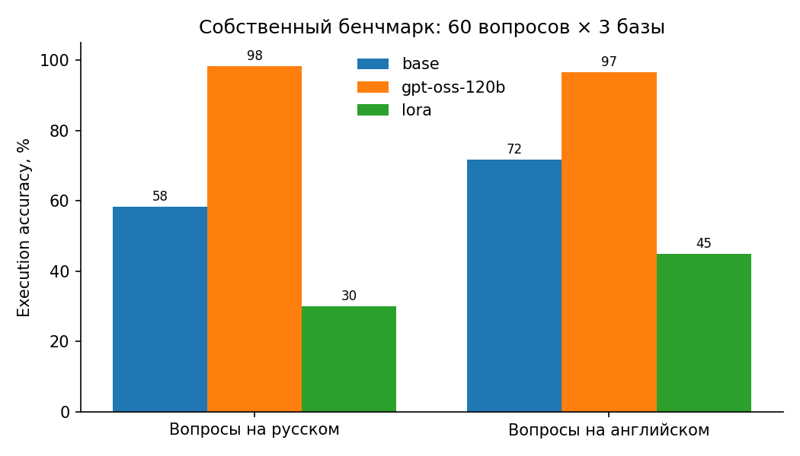
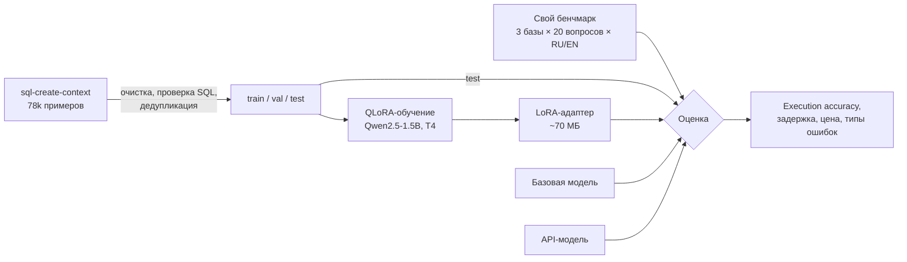

# Text-to-SQL: дообучение маленькой LLM через QLoRA с честной оценкой

[](https://github.com/sofetizm/text2sql-lora/actions/workflows/ci.yml)
[](https://colab.research.google.com/github/sofetizm/text2sql-lora/blob/main/notebooks/train_colab.ipynb)


Модель **Qwen2.5-1.5B-Instruct** дообучается на бесплатной видеокарте Colab T4 переводить вопросы на естественном языке в SQL-запросы. Затем она сравнивается с базовой моделью и коммерческой API-моделью по **точности, скорости и цене** на собственном бенчмарке.

Проект отвечает на три вопроса:

1. **Насколько маленькая дообученная модель догоняет большую API-модель** на узкой задаче и сколько это экономит?
2. **Переносится ли обучение на английских данных на вопросы на русском?** Бенчмарк двуязычный: одни и те же вопросы на RU и EN.
3. **Какие именно ошибки исправляет дообучение:** выдуманные таблицы и столбцы, синтаксис или логику запроса?

## Результаты

> Таблица генерируется командой `make report` после прогона ноутбука. Числа ниже нужно заменить своими.

| Модель | Свой бенчмарк, RU | Свой бенчмарк, EN | Easy | Medium | Hard | Held-out EM | Held-out выполнимо | Задержка, с | $ / 1000 запросов |
|---|---|---|---|---|---|---|---|---|---|
| Qwen2.5-1.5B (base) | — | — | — | — | — | — | — | — | 0 |
| Qwen2.5-1.5B + LoRA | — | — | — | — | — | — | — | — | 0 |
| API-модель | — | — | — | — | — | — | — | — | — |

<!--  -->

**Выводы** (заполнить после прогона): прирост от дообучения, разрыв RU/EN, на каких типах ошибок модель стала лучше (см. `results/compare_base_vs_lora.md`).

## Как это устроено



### Данные

Источник: [`b-mc2/sql-create-context`](https://huggingface.co/datasets/b-mc2/sql-create-context), пары «вопрос + `CREATE TABLE` → SQL». Перед обучением данные чистятся (`src/t2s/data.py`):

- удаляются дубликаты вопросов к одной и той же схеме;
- строковые литералы в `"двойных"` кавычках переводятся в стандартные `'одинарные'`;
- **каждый эталонный запрос выполняется на своей схеме**, невыполнимые выбрасываются;
- делится на train / val / test без пересечений. Статистика очистки пишется в `data/stats.json`.

### Обучение

| Решение | Почему |
|---|---|
| QLoRA: модель в 4 битах (NF4), адаптеры в fp32 | Влезает в 16 ГБ T4 с запасом |
| LoRA r=16 на всех линейных слоях attention и MLP | Обучается около 1% параметров; адаптеры только на attention заметно слабее |
| Loss только по токенам ответа | Иначе модель тратит ёмкость на заучивание `CREATE TABLE` из промпта |
| Отбрасывание примеров длиннее `max_seq_length` вместо обрезки | Обрезанный SQL учит модель обрывать запросы |
| Сохраняется только адаптер | Десятки мегабайт вместо 3 ГБ, легко выложить на Hugging Face Hub |

Все параметры лежат в `configs/qlora_qwen1.5b.yaml`, любой можно переопределить: `--set training.max_steps=100`.

### Собственный бенчмарк

Held-out выборка из того же датасета показывает, насколько модель выучила **его стиль**. Но exact match там несправедлив: `SELECT a, b` и `SELECT b, a` формально разные строки, а базы с данными в датасете нет. Поэтому есть свой бенчмарк (`benchmark/`):

- **3 базы SQLite с данными**: интернет-магазин, университет, библиотека. Данные генерируются детерминированно, с фиксированным seed;
- **60 вопросов** разной сложности (21 easy, 22 medium, 17 hard): JOIN, GROUP BY / HAVING, подзапросы, NOT IN, работа с датами, проценты;
- каждый вопрос **на русском и английском**, эталонный SQL общий;
- метрика **execution accuracy**: запрос модели выполняется на базе, и результат сравнивается с результатом эталона.

Правила сравнения результатов (`src/t2s/sql_utils.py`):

- числа округляются до 2 знаков;
- порядок столбцов не важен;
- порядок строк учитывается только при `ORDER BY` в эталоне;
- лишний `DISTINCT` не штрафуется.

Каждый запрос модели выполняется в режиме только для чтения и с таймаутом.

Качество самого бенчмарка проверяется тестами (`tests/test_benchmark.py`):

- все эталоны выполняются и возвращают непустой результат;
- значения в кавычках из вопроса совпадают с литералами в эталоне;
- в вопросах с `LIMIT` нет «ничьих» на границе, при которых правильных ответов несколько;
- базы побайтово воспроизводимы;
- oracle-бэкенд, отдающий эталоны, получает ровно 100%.

Ошибки классифицируются по типам: несуществующие таблицы и столбцы, синтаксис, неверный результат, таймаут, отсутствие SQL в ответе.

## Быстрый старт

### В Google Colab (рекомендуется)

Открой `notebooks/train_colab.ipynb` по кнопке **Open in Colab**, выбери T4 GPU и запусти ячейки по порядку. Полный цикл (данные → оценка base → обучение → оценка LoRA → отчёт) занимает ориентировочно 1,5–2 часа.

### Локально (нужна GPU от 8 ГБ)

```bash
make install
make data dbs
make eval-base
make train
make eval-lora
make eval-api API_MODEL=<модель> PRICE_IN=<$ за 1M> PRICE_OUT=<$ за 1M>   # опционально
make report compare
```

API-оценка работает с любым OpenAI-совместимым провайдером: ключ задаётся в `OPENAI_API_KEY`, адрес в `OPENAI_BASE_URL`. Цены передаются явно, потому что они меняются.

### Демо

```bash
pip install -e ".[demo]"
MODEL=Qwen/Qwen2.5-1.5B-Instruct ADAPTER=outputs/qwen1.5b-sql-lora/adapter python app.py
```

Gradio-интерфейс: выбираешь базу, задаёшь вопрос на русском или английском и видишь SQL и результат его выполнения. Подходит для Hugging Face Spaces.

## Структура

```
├── src/t2s/
│   ├── data.py           # загрузка, очистка, сплиты
│   ├── train.py          # QLoRA-обучение, маскирование промпта в loss
│   ├── backends.py       # HF-модель (+LoRA), OpenAI-совместимое API, oracle
│   ├── evaluate.py       # execution accuracy, exact match, скорость, цена, типы ошибок
│   ├── report.py         # таблица RESULTS.md + график
│   ├── compare.py        # что дообучение исправило / сломало
│   ├── benchmark_db.py   # генерация баз бенчмарка
│   ├── sql_utils.py      # извлечение SQL, безопасное выполнение, сравнение результатов
│   └── prompts.py        # единый формат промпта
├── benchmark/questions.jsonl
├── configs/qlora_qwen1.5b.yaml
├── notebooks/train_colab.ipynb
├── tests/                # unit-тесты + smoke-тест обучения на CPU
├── app.py                # Gradio-демо
└── .github/workflows/ci.yml
```

## Тесты

```bash
pytest            # быстрые тесты: SQL-утилиты, бенчмарк, данные, отчёты
pytest -m slow    # обучает крошечную случайную модель на CPU и проверяет весь пайплайн LoRA
```

В CI на каждый push запускаются линтер, быстрые тесты и smoke-обучение на CPU.

## Ограничения и что дальше

- 60 вопросов мало для статистически строгих выводов: разница в 2–3 п.п. может быть шумом. Дальше стоит добавить [Spider](https://yale-lily.github.io/spider) или BIRD.
- Данные в базах синтетические. На реальных схемах с сотнями столбцов задача сложнее.
- Обучающие данные только на английском. Следующий шаг — перевод части датасета на русский и замер изменения разрыва RU/EN.
- Можно улучшить без обучения: self-consistency (несколько вариантов SQL и голосование по результату выполнения) и исправление запроса по тексту ошибки.
- Можно улучшить обучением: DPO на парах «правильный / неправильный запрос», где правильность проверяется выполнением.

## Лицензия

MIT
