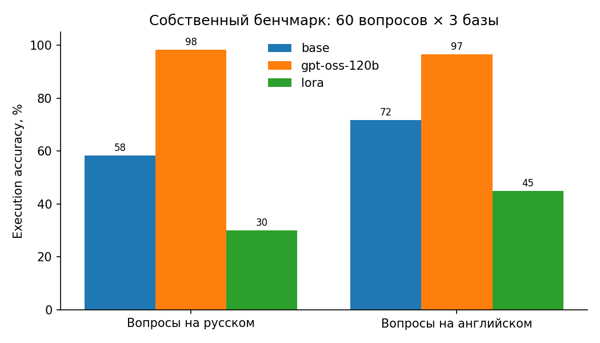

# Результаты

| Модель | Свой бенчмарк, RU | Свой бенчмарк, EN | Easy | Medium | Hard | Held-out EM | Held-out выполнимо | Задержка, с | Токенов/с | $ / 1000 запросов |
|---|---|---|---|---|---|---|---|---|---|---|
| **base** | 58.3 | 71.7 | 81.0 | 63.6 | 47.1 | 55.0 | 96.7 | 0.939 | 35.1 | 0.0 |
| **gpt-oss-120b** | 98.3 | 96.7 | 100.0 | 95.5 | 97.1 | — | — | 0.372 | 162.3 | 0.0857 |
| **lora** | 30.0 | 45.0 | 31.0 | 43.2 | 38.2 | 79.7 | 99.3 | 0.928 | 31.6 | 0.0 |

## Типы ошибок на своём бенчмарке

| Модель | несуществующие таблицы/столбцы | синтаксис | выполнился, но ответ неверный |
|---|---|---|---|
| **base** | 19 | 6 | 17 |
| **gpt-oss-120b** | 0 | 1 | 2 |
| **lora** | 35 | 3 | 37 |

